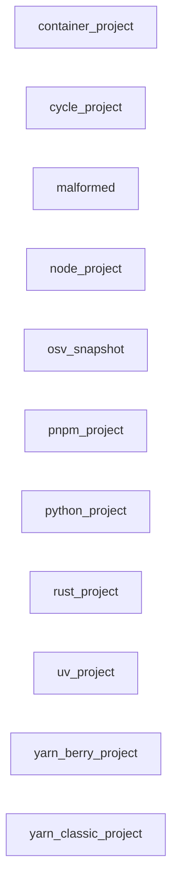

_Generated by CodeAtlas._

## Details

Owns 0 symbols across 0 file(s).

### container_project

Owns 0 symbols across 2 file(s).

**Related Classes/Methods:** _None_

### cycle_project

Owns 0 symbols across 1 file(s).

**Related Classes/Methods:** _None_

### malformed

Owns 0 symbols across 3 file(s).

**Related Classes/Methods:** _None_

### node_project

Owns 0 symbols across 2 file(s).

**Related Classes/Methods:** _None_

### osv_snapshot

Owns 0 symbols across 3 file(s).

**Related Classes/Methods:** _None_

### pnpm_project

Owns 0 symbols across 2 file(s).

**Related Classes/Methods:** _None_

### python_project

Owns 0 symbols across 3 file(s).

**Related Classes/Methods:** _None_

### rust_project

Owns 0 symbols across 2 file(s).

**Related Classes/Methods:** _None_

### uv_project

Owns 0 symbols across 2 file(s).

**Related Classes/Methods:** _None_

### yarn_berry_project

Owns 0 symbols across 1 file(s).

**Related Classes/Methods:** _None_

### yarn_classic_project

Owns 0 symbols across 2 file(s).

**Related Classes/Methods:** _None_
