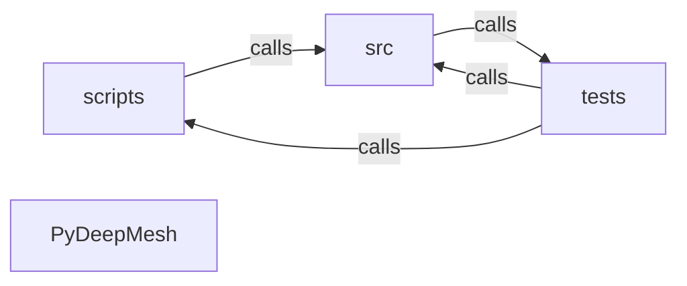

_Generated by CodeAtlas._

## Details

Architecture map of PyDeepMesh.

### scripts

Owns 13 symbols across 1 file(s).

**Related Classes/Methods:** _None_

**Source Files:**

- `scripts/check_boundaries.py`
  - `scripts.check_boundaries.Violation`
  - `scripts.check_boundaries.Violation.__str__`
  - `scripts.check_boundaries._analyze_imports`
  - `scripts.check_boundaries._check_sibling_imports`
  - `scripts.check_boundaries._check_sibling_references_text`
  - `scripts.check_boundaries._iter_files`
  - `scripts.check_boundaries._skip_dir`
  - `scripts.check_boundaries.check_escaping_symlinks`
  - `scripts.check_boundaries.check_path_dependencies`
  - `scripts.check_boundaries.check_sibling_directories`
  - `scripts.check_boundaries.check_sibling_references`
  - `scripts.check_boundaries.check_submodules_and_nested_repos`
  - `scripts.check_boundaries.main`

### src

Owns 0 symbols across 0 file(s).

**Related Classes/Methods:** _None_

### tests

Owns 140 symbols across 16 file(s).

**Related Classes/Methods:** _None_

**Source Files:**

- `tests/conftest.py`
  - `tests.conftest.config`
- `tests/helpers.py`
  - `tests.helpers.FakeProvider`
  - `tests.helpers.FakeProvider.__init__`
  - `tests.helpers.FakeProvider.query`
  - `tests.helpers.make_advisory`
  - `tests.helpers.scan_fixture`
- `tests/test_api.py`
  - `tests.test_api.test_advisory_provider_selection`
  - `tests.test_api.test_audit_directory_uses_snapshot`
  - `tests.test_api.test_make_report_and_sarif_and_cyclonedx`
  - `tests.test_api.test_python_dash_m`
  - `tests.test_api.test_scan_directory`
- `tests/test_cli.py`
  - `tests.test_cli.test_advisories_clear`
  - `tests.test_cli.test_advisories_update_requires_online`
  - `tests.test_cli.test_audit_fail_on_never_returns_ok`
  - `tests.test_cli.test_audit_fail_on_triggers_findings`
  - `tests.test_cli.test_audit_offline_without_source_requires_advisory`
  - `tests.test_cli.test_audit_with_snapshot_finds_express`
  - `tests.test_cli.test_graph_cycles`
  - `tests.test_cli.test_graph_roots_json`
  - `tests.test_cli.test_missing_path_is_usage_error`
  - `tests.test_cli.test_output_is_confined_to_output_root`
  - `tests.test_cli.test_output_within_root_writes_file`
  - `tests.test_cli.test_sbom_output`
  - `tests.test_cli.test_scan_json`
  - `tests.test_cli.test_scan_terminal`
- `tests/test_config.py`
  - `tests.test_config.test_defaults_are_offline_and_bounded`
  - `tests.test_config.test_env_overrides`
  - `tests.test_config.test_file_overrides`
  - `tests.test_config.test_invalid_env_int_raises`
  - `tests.test_config.test_invalid_type_in_file_raises`
  - `tests.test_config.test_missing_file_raises`
- `tests/test_graph.py`
  - `tests.test_graph._ids`
  - `tests.test_graph.test_cycle_detection`
  - `tests.test_graph.test_graph_dict_is_stable`
  - `tests.test_graph.test_paths_are_deterministic`
  - `tests.test_graph.test_reachability_and_reverse`
- `tests/test_matching.py`
  - `tests.test_matching.test_confirmed_match`
  - `tests.test_matching.test_git_range_is_potential`
  - `tests.test_matching.test_match_never_raises`
  - `tests.test_matching.test_snapshot_missing_directory_is_unavailable`
  - `tests.test_matching.test_snapshot_provider_offline`
  - `tests.test_matching.test_snapshot_severity_normalization`
  - `tests.test_matching.test_unaffected_package_is_unmatched_not_safe`
  - `tests.test_matching.test_unavailable_provider_reports_unavailable`
- `tests/test_net.py`
  - `tests.test_net.FakeOpener`
  - `tests.test_net.FakeOpener.__init__`
  - `tests.test_net.FakeOpener.open`
  - `tests.test_net.FakeResponse`
  - `tests.test_net.FakeResponse.__enter__`
  - `tests.test_net.FakeResponse.__exit__`
  - `tests.test_net.FakeResponse.__init__`
  - `tests.test_net.FakeResponse.read`
  - `tests.test_net._no_sleep`
  - `tests.test_net._patch_opener`
  - `tests.test_net.test_client_error_is_not_retried`
  - `tests.test_net.test_client_error_is_not_retried.not_found`
  - `tests.test_net.test_network_error_exhausts_retries`
  - `tests.test_net.test_network_error_exhausts_retries.boom`
  - `tests.test_net.test_redirect_handler_rejects_downgrade`
  - `tests.test_net.test_rejects_non_https`
  - `tests.test_net.test_response_size_cap`
  - `tests.test_net.test_retries_then_succeeds`
  - `tests.test_net.test_retries_then_succeeds.flaky`
  - `tests.test_net.test_successful_request`
- `tests/test_osv.py`
  - `tests.test_osv.StubTransport`
  - `tests.test_osv.StubTransport.__init__`
  - `tests.test_osv.StubTransport.request`
  - `tests.test_osv._Response`
  - `tests.test_osv._Response.__init__`
  - `tests.test_osv._Response.json`
  - `tests.test_osv._query`
  - `tests.test_osv.test_osv_malformed_batch_is_unavailable`
  - `tests.test_osv.test_osv_malformed_record_raises`
  - `tests.test_osv.test_osv_no_supported_queries`
  - `tests.test_osv.test_osv_passes_version_in_batch`
  - `tests.test_osv.test_osv_passes_version_in_batch.Capturing`
  - `tests.test_osv.test_osv_passes_version_in_batch.Capturing.request`
  - `tests.test_osv.test_osv_query_returns_normalized_advisories`
  - `tests.test_osv.test_osv_unavailable_on_transport_error`
  - `tests.test_osv.test_osv_uses_cache_for_records`
- `tests/test_parsers.py`
  - `tests.test_parsers._node`
  - `tests.test_parsers.test_container_graph`
  - `tests.test_parsers.test_every_fixture_has_a_project_root`
  - `tests.test_parsers.test_malformed_inputs_never_raise`
  - `tests.test_parsers.test_node_graph`
  - `tests.test_parsers.test_pnpm_graph_with_scoped_package`
  - `tests.test_parsers.test_python_editable_and_constraint_diagnostics`
  - `tests.test_parsers.test_python_graph_resolution`
  - `tests.test_parsers.test_rust_graph`
  - `tests.test_parsers.test_scan_is_deterministic`
  - `tests.test_parsers.test_uv_lock_graph`
  - `tests.test_parsers.test_yarn_berry_graph`
  - `tests.test_parsers.test_yarn_classic_graph`
- `tests/test_reports.py`
  - `tests.test_reports._audit`
  - `tests.test_reports.test_json_report_contains_timestamp_when_requested`
  - `tests.test_reports.test_json_report_is_deterministic`
  - `tests.test_reports.test_json_report_shape`
  - `tests.test_reports.test_sarif_level_mapping`
  - `tests.test_reports.test_sarif_matches_schema`
  - `tests.test_reports.test_terminal_report_reports_unavailable`
- `tests/test_risk.py`
  - `tests.test_risk._findings`
  - `tests.test_risk.test_concentration_counts_fan_in`
  - `tests.test_risk.test_deep_depth_downgrade`
  - `tests.test_risk.test_direct_dependency_escalates_priority`
  - `tests.test_risk.test_findings_are_sorted_by_priority`
  - `tests.test_risk.test_no_remediation_when_no_fixed_version`
  - `tests.test_risk.test_priority_remains_within_bounds`
  - `tests.test_risk.test_remediation_recommends_earliest_fixed`
  - `tests.test_risk.test_unavailable_packages_surface_in_analysis`
- `tests/test_sbom.py`
  - `tests.test_sbom.test_cyclonedx_components_have_purls`
  - `tests.test_sbom.test_cyclonedx_dependencies_reference_known_components`
  - `tests.test_sbom.test_cyclonedx_is_deterministic_without_timestamp`
  - `tests.test_sbom.test_cyclonedx_matches_schema`
  - `tests.test_sbom.test_cyclonedx_serial_number_stable`
  - `tests.test_sbom.test_cyclonedx_spec_version`
- `tests/test_security.py`
  - `tests.test_security.test_cache_keys_cannot_escape_directory`
  - `tests.test_security.test_discovery_missing_root`
  - `tests.test_security.test_discovery_skips_symlink_escape`
  - `tests.test_security.test_ensure_output_path_accepts_within`
  - `tests.test_security.test_ensure_output_path_rejects_escape`
  - `tests.test_security.test_ensure_within_accepts_inside`
  - `tests.test_security.test_ensure_within_rejects_escape`
  - `tests.test_security.test_safe_read_text_missing_file`
  - `tests.test_security.test_safe_read_text_too_large`
- `tests/test_versioning.py`
  - `tests.test_versioning.test_cvss_base_score`
  - `tests.test_versioning.test_earliest_fixed_version`
  - `tests.test_versioning.test_explicit_versions`
  - `tests.test_versioning.test_git_range_is_unevaluable`
  - `tests.test_versioning.test_pep440_compare`
  - `tests.test_versioning.test_semver_compare`
  - `tests.test_versioning.test_semver_parse_partial`
  - `tests.test_versioning.test_version_in_range_introduced_fixed`
  - `tests.test_versioning.test_version_in_range_last_affected`
  - `tests.test_versioning.test_version_in_range_limit`
- `tests/test_viewer.py`
  - `tests.test_viewer.test_cli_graph_html`
  - `tests.test_viewer.test_viewer_contains_nodes_and_edges`
  - `tests.test_viewer.test_viewer_document_shape`
  - `tests.test_viewer.test_viewer_escapes_untrusted_labels`
  - `tests.test_viewer.test_viewer_is_deterministic`
  - `tests.test_viewer.test_viewer_is_self_contained`

### PyDeepMesh

Owns 0 symbols across 10 file(s).

**Related Classes/Methods:** _None_
