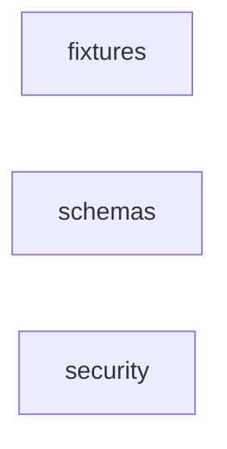

_Generated by CodeAtlas._

## Details

Owns 140 symbols across 16 file(s).

### fixtures

Owns 0 symbols across 0 file(s).

**Related Classes/Methods:** _None_

### schemas

Owns 0 symbols across 2 file(s).

**Related Classes/Methods:** _None_

### security

Owns 8 symbols across 1 file(s).

**Related Classes/Methods:** _None_

**Source Files:**

- `tests/security/test_repository_boundaries.py`
  - `tests.security.test_repository_boundaries._load_checker`
  - `tests.security.test_repository_boundaries.test_checker_detects_nested_repo`
  - `tests.security.test_repository_boundaries.test_checker_detects_path_dependency`
  - `tests.security.test_repository_boundaries.test_checker_detects_sibling_directory`
  - `tests.security.test_repository_boundaries.test_checker_detects_sibling_reference`
  - `tests.security.test_repository_boundaries.test_checker_does_not_skip_sibling_named_dirs`
  - `tests.security.test_repository_boundaries.test_checker_flags_sibling_import_structurally`
  - `tests.security.test_repository_boundaries.test_checker_runs_clean_on_this_repo`
